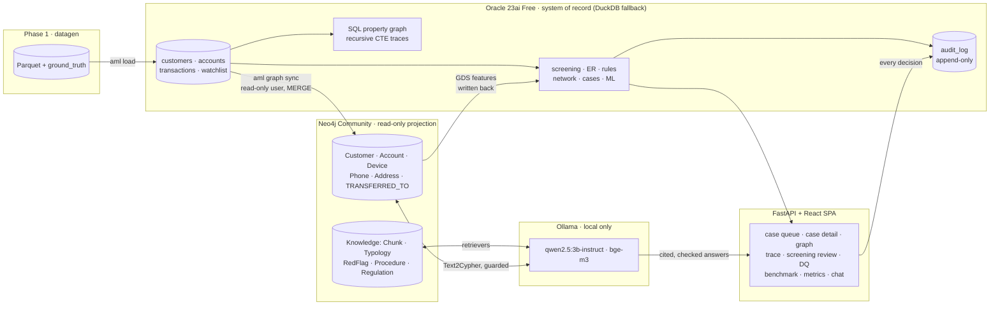

# AML Investigation Toolkit (interview demo)

Custom tools that reduce AML investigation effort, on **synthetic data only**:
Vietnamese-name screening, entity resolution, transaction monitoring, SQL-vs-graph network
analysis, alert consolidation/prioritization, ML additions with model governance, a local GraphRAG
investigator assistant and an investigator UI. Oracle is the system of record; Neo4j is a read-only
investigation projection; everything also runs on DuckDB with zero setup.

> Status: **all phases done** (0 to 10). Every number in this file comes from an actual run on this
> code, with the command that produced it and the raw output under [results/](results/). Nothing is
> estimated or copied from a paper. Talking points for the interview are in
> [docs/INTERVIEW_NOTES.md](docs/INTERVIEW_NOTES.md); a guided tour of the code, following one alert
> from generator to investigator, is in [docs/WALKTHROUGH.md](docs/WALKTHROUGH.md).

## The problem

An AML investigator's day goes into work that is not investigation:

| Where the effort goes | What usually causes it | Tool in this repo |
|---|---|---|
| Reading screening hits that are obviously not the listed person | Phonetic or plain fuzzy matching on Vietnamese names, no secondary identifiers | Two-tier screening with IDF-weighted Vietnamese name scoring and auto-clear reasons (Phase 3), a learned ranking of the remaining hits (7b) |
| The same person investigated three times under three CIFs | No golden customer id | Splink entity resolution with match weights per cluster (Phase 4) |
| Alerts without evidence, or rules nobody can explain | Rules living in a vendor black box | Rules in plain SQL on both Oracle and DuckDB, each alert with its evidence transactions and a human-readable reason (Phase 5) |
| "Where did the money go?" answered by hand | Tracing is slow or needs a second system | Four implementations of the fund-flow trace, benchmarked, so the SQL-vs-graph choice is a measured one (Phases 5b, 6) |
| Ten alerts on one customer opened as ten cases | Alerts are consolidated per account, not per person | One case per golden customer, enriched with KYC, linked CIFs, DQ issues, activity, network features and history (Phase 7) |
| The queue is worked in arrival order | No ranking, or a ranking nobody trusts | A versioned ranking model with top factors per case, below-the-line measurement and a model card; it never closes anything (Phases 7, 7b) |
| Repeated false positives come back every month | No suppression with an audit trail | Good-guy list and hibernation, applied per item with a reason, lifted on material change (Phase 7) |
| Writing the narrative from five screens | No assistant, or one that invents facts | Local GraphRAG assistant whose every sentence is checked against the evidence before it is shown (Phase 8) |
| Proving to an auditor why something happened | Decisions not recorded | Append-only `audit_log` with actor, reason and rule/model/prompt version on every automated decision (Phase 0 onwards) |

## Architecture



Oracle holds the data, the rules, the traces and the DBA practice (partitioning, roles, masking view,
unified audit, retention, DQ framework). Neo4j is synced from Oracle through a read-only user and is
only ever read: Community edition has no RBAC, so read-only behaviour comes from READ access-mode
sessions plus an application guard that rejects write clauses. The assistant and the UI read from both,
and every decision a person or a model takes lands in `audit_log`. Set `DB_BACKEND=duckdb` (the default)
and everything except the Oracle-only features runs in one process with no Docker.

## Setup

Requirements: Python 3.11 and [uv](https://docs.astral.sh/uv/); Docker Desktop for the optional
services; Node.js (the build was run on v24) for the UI. The numbers in this file were produced on one developer laptop
(Windows 11, Intel i5-12400F with 12 logical CPUs, 16 GB RAM, NVIDIA GTX 1650 with 4 GB VRAM) with
the services in local Docker containers.

| Mode | What you get | Start | Docker memory limit (`docker-compose.yml`) |
|---|---|---|---|
| DuckDB only | everything except the Oracle-only features (partitioning, roles, retention, property graph, tuning demo), Neo4j features and the LLM | nothing to start | 0 |
| Oracle | the system of record: schema, DBA scripts, `pgq` trace, SQL screen comparison | `.\tasks.ps1 up -ComposeProfile oracle` (or `make up PROFILE=oracle`) | 3 GB |
| Neo4j | projection sync, Cypher queries, GDS features, the `neo4j` trace, the assistant's graph | `up -ComposeProfile graph` | 2.5 GB (1 GB heap, 512 MB page cache) |
| Ollama | memo classification, the assistant, the RAG evaluation | `up -ComposeProfile llm` (GPU block in `docker-compose.yml`; remove it for CPU) | 5 GB; `qwen2.5:3b-instruct` + `bge-m3` ran on the 4 GB GPU |
| Full stack | all of the above | `up -ComposeProfile full` | 10.5 GB |

```powershell
uv sync                                   # Python 3.11 env + deps (uv sync --extra ml adds LightGBM)
cp .env.example .env                      # passwords for Oracle / Neo4j (git-ignored, shared with docker compose)
uv run aml status                         # active config + which optional services are up
uv run aml init-db                        # schema on the configured backend (idempotent)
uv run pytest                             # Oracle / Neo4j / Ollama tests skip with a message when the service is down
```

The pipeline, end to end, on the `small` profile (5,000 customers, 306,000 transactions over 6 months):

```powershell
uv run aml data ; uv run aml load          # Parquet + ground truth -> database (~4 s + ~4 s)
uv run aml screen --eval-out results/phase3/screening_eval.csv
uv run aml er --eval-out results/phase4/er_eval.csv
uv run aml monitor --eval-out results/phase5/monitor_eval.csv
uv run aml network --eval-out results/phase5/network_eval.csv
uv run aml dq run
uv run aml graph sync --full ; uv run aml graph gds            # Neo4j
uv run aml bench                                               # the four traces, both profiles
uv run aml cases build ; uv run aml score                      # cases, simulated dispositions, ranking
uv run aml anomaly run ; uv run aml screen-ml run ; uv run aml cases btl --train ; uv run aml models card
uv run aml rag build --full ; uv run aml memo classify ; uv run aml rag eval    # Ollama + Neo4j
npm --prefix web install ; npm --prefix web run build ; uv run aml ui           # http://127.0.0.1:8000
```

`make all` and `.\tasks.ps1 all` run the data-to-RAG part. Configuration lives in
[config.yaml](config.yaml): thresholds, profiles (`small` / `dense` / `large`), seeds and model names.
Override any key with `AML__<SECTION>__<KEY>=value` or `DB_BACKEND=oracle|duckdb`. All generated data is
reproducible from `seed`.

## Synthetic data and the Oracle schema (Phases 1, 2)

`aml data` writes nine Parquet tables with a manifest: Vietnamese names with diacritics and realistic
surname frequency, CCCD / CMND / passport ids, mixed phone formats, old and post-2025 addresses with an
`admin_unit_mapping`, about 8% of persons with 2 to 3 CIFs, configurable DQ defects, five channels,
Vietnamese memos including planted prompt-injection and gambling-like / crypto-like memos, and a
`ground_truth` table for every planted scenario. On `small` (seed 42) that is 338,753 rows in 4.1 s and
a 3.7 s load; the planted scenarios are 20 structuring, 20 rapid movement, 5 mule rings, 15
round-tripping, 5 benign payroll and 5 benign merchant look-alikes, plus a 2,000-entry watchlist with 20
true hits and 30 trap entries. Specs: [datagen-customers](specs/datagen-customers.md),
[datagen-transactions](specs/datagen-transactions.md), [datagen-typologies](specs/datagen-typologies.md),
[datagen-watchlist-output](specs/datagen-watchlist-output.md), [datagen-memos](specs/datagen-memos.md).

The Oracle side is built the way a DBA would build it, and the evidence is captured, not described:

| Practice | Where | Evidence |
|---|---|---|
| `transactions` in monthly interval partitions with local indexes; `audit_log` partitioned the same way | `sql/oracle/ddl/020_*`, `070_*` | `uv run aml explain-pruning` writes `PARTITION RANGE SINGLE / ITERATOR / ALL` plans to [results/phase2/partition_pruning.txt](results/phase2/partition_pruning.txt) |
| Named constraints, FK indexes, `DBMS_STATS` with incremental stats, `acct_edge_daily` as a materialized view | `030_*`, `040_*`, `src/aml/dba/` | DDL is idempotent (`EXECUTE IMMEDIATE`, ORA-00955 swallowed) |
| Four least-privilege roles (`aml_app`, `aml_analyst`, `aml_graph_sync`, `aml_auditor`), a `customers_masked` view for analysts, unified audit policies on PII tables, triggers that make `audit_log` append-only | `sql/oracle/security/`, `050_*` | `uv run aml security-setup`; the masked view is checked against a Python reference on both backends |
| Retention: archive partitions to Parquet, verify the row count, drop with `UPDATE GLOBAL INDEXES`; a 60-month legal floor the config cannot go below | `src/aml/dba/retention.py` | `uv run aml retention` (dry-run by default) |
| DQ framework: 10 rules (completeness, validity, uniqueness, consistency, timeliness) as one `SELECT` each, `dq_results` with a trend view | `sql/common/dq/`, `src/aml/dq/` | `uv run aml dq run` prints the results and the agreement with the generator's DQ labels |
| Runbook: backup / restore on Free, AWR / ASH / Statspack, reading `DBMS_XPLAN`, MV refresh, partition maintenance, a tuning walkthrough | [dba/RUNBOOK.md](dba/RUNBOOK.md), `dba/scripts/` | captured outputs in [results/phase2/runbook/](results/phase2/runbook/) |

The tuning walkthrough (`uv run aml tune-demo`, 2026-10-10, `small`, 5 runs per variant): a 30-day
outflow query with `TRUNC(txn_ts)` on the partition key scans every partition; the half-open range on
the bare column prunes to one.

| Variant | plan | buffer_gets | elapsed ms (median) |
|---|---|---|---|
| before: `TRUNC(txn_ts) BETWEEN ...` | PARTITION RANGE ALL | 4,449 | 60.4 |
| after: `txn_ts >= ... AND txn_ts < ...` | PARTITION RANGE SINGLE | 752 | 5.3 |

Both return 155 rows; no hints, indexes or statistics changes were involved. Buffer gets are the
number to compare across machines. The relational schema is drawn in [docs/erd/](docs/erd/README.md),
and the rules are mapped to the Vietnamese AML law in [docs/legal/rule-mapping.md](docs/legal/rule-mapping.md).

## Name screening (Phase 3)

Names are normalised (diacritics, legal-entity terms, order-free token key), scored with
`token_set_ratio` + Jaro-Winkler and weighted by token rarity (IDF from the customer base), so a match
on only `NGUYEN VAN` scores low. Tier 1 blocks on a token index; Tier 2 uses date of birth
(year-only tolerant), nationality and gender to discount or auto-clear. Every pair gets `ALERT`,
`REVIEW` or `AUTO_CLEARED` with a reason such as `DOB mismatch > 5y (name score 100.00, DOB gap 36y)`.
Result of `uv run aml screen --eval-out results/phase3/screening_eval.csv` on `small` (seed 42,
2026-10-11; 5,000 customers against 2,000 entries with aliases, 25 true customer-entry pairs):

| Method | Flagged | True | False | Missed | Precision | Recall | Fewer false flags than plain fuzzy |
|---|---|---|---|---|---|---|---|
| exact match | 137 | 24 | 113 | 1 | 0.175 | 0.96 | 97.4% |
| plain fuzzy at the same threshold | 4,436 | 25 | 4,411 | 0 | 0.006 | 1.00 | 0 |
| two-tier, `ALERT` only | 41 | 25 | 16 | 0 | 0.610 | 1.00 | 99.6% |
| two-tier, `ALERT` + `REVIEW` | 72 | 25 | 47 | 0 | 0.347 | 1.00 | 98.9% |

- Soundex and Metaphone are rejected with a measurement: the 228 distinct tokens of `small` collapse
  into 115 codes (`HOANG`, `HONG`, `HUNG`, `HUONG` share one). See [docs/screening.md](docs/screening.md).
- The in-database comparison (`uv run aml screen-compare`, `UTL_MATCH.JARO_WINKLER_SIMILARITY` on
  Oracle) keeps all 25 true pairs but returns 4,737 pairs at precision 0.005: pure Jaro-Winkler is as
  noisy as the fuzzy baseline, so Python keeps IDF weighting, Tier 2 and the stored reason.
- Incremental screening (`--incremental`) fingerprints the fields that feed a decision and freezes the
  IDF at the last full run, so a delta run equals a full run on the same IDF. On the test data set
  three changes needed 7 candidate pairs instead of 262.
- Specs: [screening-normalize-score](specs/screening-normalize-score.md),
  [screening-tiers-eval](specs/screening-tiers-eval.md),
  [screening-oracle-incremental](specs/screening-oracle-incremental.md).

## Entity resolution (Phase 4)

Splink (DuckDB backend) with blocking on normalised phone, normalised id (CMND and CCCD handled) and
province after the old-to-new mapping; comparisons on name, DOB, phone, email, address and id; fixed
m-probabilities from config, u estimated from random pairs. Clusters become `golden_customer_id`, and
`uv run aml er --explain G-...` shows the match weights of one cluster. Result of
`uv run aml er --eval-out results/phase4/er_eval.csv` on `small` (seed 42, Splink 5.0.0, 2026-10-12):

| | Value |
|---|---|
| pairs scored after blocking | 736 |
| `MATCH` / `REVIEW` pairs | 546 / 0 |
| clusters (with 2+ CIFs) | 4,545 (364) |
| pairwise precision / recall | 1.00 / 1.00 (546 of 546 injected duplicate pairs) |
| cluster precision / recall | 1.00 / 1.00 (364 of 364) |

The perfect score says the pipeline is wired correctly, not that the model is tuned: the generator
never changes the phone digits or the DOB between the CIFs of one person. The acceptance tests add
four hand-made cases (a changed phone, a namesake with the same DOB, two relatives sharing phone and
address, a duplicate that moved province) to show one `REVIEW`, one wrong merge and one miss.
Details and limits: [docs/entity-resolution.md](docs/entity-resolution.md),
spec [entity-resolution](specs/entity-resolution.md).

## Transaction monitoring and network detections (Phase 5)

Five rules, each one `.sql` file per backend with parameters from config, write to `alerts` with the
rule id, rule version, the evidence transaction ids and a reason. Three network detections run in
NetworkX on the same tables. Results of `uv run aml monitor --eval-out results/phase5/monitor_eval.csv`
and `uv run aml network --eval-out results/phase5/network_eval.csv` on `small` (seed 42, 2026-10-12),
against the planted scenarios:

| Detection | Target typology | Alerts | On the target | On another suspicious scenario | On a benign scenario | Scenarios caught |
|---|---|---|---|---|---|---|
| `STRUCTURING` | structuring | 20 | 20 | 0 | 0 | 20 / 20 |
| `RAPID_MOVEMENT` | rapid movement | 45 | 20 | 24 | 0 | 20 / 20 |
| `FAN_IN` | mule ring | 5 | 5 | 0 | 0 | 5 / 5 |
| `FAN_OUT` | mule ring | 20 | 20 | 0 | 0 | 5 / 5 |
| `HIGH_VELOCITY` | none planted | 15 | n/a | 15 | 0 | n/a |
| `DORMANT_REACTIVATION` | none planted | 137 | n/a | 136 | 0 | n/a |
| `NET_SHARED_ATTRIBUTE` | mule ring | 5 | 5 | 0 | 0 | 5 / 5 |
| `NET_CYCLE` | round-tripping | 15 | 15 | 0 | 0 | 15 / 15 |
| `NET_HUB` | mule ring | 5 | 5 | 0 | 0 | 5 / 5 |

- Every planted suspicious scenario is caught and no benign look-alike (payroll, merchant) raises an
  alert. That is what the generator makes possible, not evidence about real data: the rules and the
  generator were written from the same typology descriptions, and the only noise is the background
  activity (1 `RAPID_MOVEMENT` and 1 `DORMANT_REACTIVATION` alert fell on unlabelled accounts).
- `DORMANT_REACTIVATION` fires 137 times, almost all on accounts that belong to some planted scenario
  rather than on its own typology. In production this rule would be the noisy one, and the
  consolidation of Phase 7 is what keeps it from becoming 137 cases.
- Fund-flow tracing (`uv run aml trace --account A... --hops N --hours T --method ...`) has four
  implementations of the same question: a recursive CTE on raw transactions with Oracle's
  `CYCLE ... SET` clause, a recursive CTE on `acct_edge_daily` with an amount floor and a top-K per hop,
  an Oracle 23ai SQL property graph (`GRAPH_TABLE ... MATCH`) and Neo4j Cypher. They are benchmarked in
  Phase 6 below.
- Specs: [monitoring-rules](specs/monitoring-rules.md), [fund-flow-trace](specs/fund-flow-trace.md),
  [network-detections](specs/network-detections.md).

## Fund-flow trace: SQL vs property graph vs Neo4j (Phase 6)

The same question ("trace money out of an account, N hops within T hours, time-ordered, no account twice") is
implemented four ways and timed by `uv run aml bench`. Median ms on Oracle for the heaviest account of the
`small` profile over a 30-day window, from the run of 2026-10-13 (10 timed runs per cell, one dev machine):

| hops | paths | recursive CTE (`cte_raw`) | Oracle SQL property graph (`pgq`) | Neo4j Cypher (`neo4j`) |
|---|---|---|---|---|
| 2 | 4,289 | 43.6 | 48.6 | 226.0 |
| 4 | 10,955 | 160.7 | 262.8 | 577.6 |
| 6 | 22,394 | 405.3 | 7588.8 | 1184.1 |

All three return the same number of paths in every cell. The recursive CTE is the fastest, the property graph is
close to it at 2 hops (within 1 ms to 1.8 times slower) and falls far behind with depth, and Neo4j is 2.3 to 5.2 times slower than the CTE across both profiles while costing a
42 to 51 s full sync and a second service. So Oracle stays the system of record for traces, and Neo4j is an
optional read-only projection for investigation (pattern queries, graph algorithms). The full tables for
`small` and `dense`, p95, the method, the limits and the reasoning are in
[docs/trace-benchmark.md](docs/trace-benchmark.md); the raw results are in
[results/phase6/](results/phase6/bench_report.md).

The projection itself: `uv run aml graph sync --full` sends 28,914 nodes and 443,051 relationships from
`small` in 42 to 44 s through a dedicated read-only Oracle user, with `MERGE` so a rerun is a no-op
(1.9 to 2.2 s when nothing is new); sync lag is measured in data time and `in_sync` compares counts with
the source after every run. `uv run aml graph gds` streams WCC, Louvain, PageRank and degree from GDS
without writing to Neo4j and stores them in Oracle as case features (52 components, 151 communities,
260 shared-attribute clusters on `small`, 3.1 s; degrees equal the NetworkX features on all 8,958
accounts, PageRank within 1e-8). Related: [docs/neo4j-sync.md](docs/neo4j-sync.md),
[docs/neo4j-queries.md](docs/neo4j-queries.md) (Cypher queries), [docs/neo4j-gds.md](docs/neo4j-gds.md).

## Cases: consolidation, suppression, prioritization, summary (Phase 7)

Screening hits, rule alerts and network alerts are merged into **one case per golden customer** over a
90-day window, enriched so an investigator does not need another system (KYC, linked CIFs, data-quality
issues, 90-day activity, network features, prior cases), ranked by a model, and summarised in markdown
without an LLM. The numbers below come from one run on the `small` profile (DuckDB, `as_of` 2026-06-30,
seed 42) on 2026-10-13, starting from empty case tables:

```powershell
uv run aml cases build                                  # 339 alerts -> 475 items -> 335 cases
uv run aml score --eval-out results/phase7/eval.json    # build, simulate dispositions, rebuild, train, score
uv run aml cases suppressed                             # what suppression held back, with the reason
uv run aml cases summary --all --out-dir data/summaries # 309 markdown summaries
```

| Step | Result |
|---|---|
| Consolidation | 339 alerts became 475 case items (a group alert joins the case of every customer in it) and 335 cases |
| Simulated dispositions | 234 cases in 70% of the case groups were given the ground-truth outcome: 200 suspicious, 34 false positive; 101 cases stayed open |
| Suppression after those clearances | 36 screening items held back by the good-guy list, 0 by hibernation; 26 cases left the queue, 309 remained |
| Model `prio/logreg/1` (5 grouped folds, 234 cases) | ROC-AUC 0.9599, PR-AUC 0.9865 at 85.5% prevalence |
| Held-out queue (101 open cases, never trained on) | ROC-AUC 0.9868, PR-AUC 0.9985 at 90.1% prevalence; 8 of the 10 false positives are in the bottom 10% of the queue and all 10 in the bottom 20% |

Running `uv run aml score` a second time on the same data labelled 0 new cases and reproduced the same
queue and the same metrics.

How to read these numbers:

- **The model only ranks.** It never closes, clears or suppresses a case; every score is written to
  `audit_log` with the model version and its top contributing features. Closing a case takes a
  disposition, and only a disposition feeds the good-guy list.
- **The class imbalance is the reverse of production.** On this synthetic data the rules rarely fire on
  normal behaviour, so about 86% of cases are truly suspicious and the minority class is the false
  positive. With that prevalence a random ordering already has about 0.9 precision at the top, so the
  useful measure is how far down the queue the false positives are pushed, not precision at the top.
- **Metrics cover alerted cases only.** Customers who never raised an alert are not in this run, so it says
  nothing about what the rules miss (selection bias). The below-the-line sample of Phase 7b below measures that.
- **Labels are simulated.** Dispositions are derived from the generator's ground truth, not from analysts,
  so they are noise-free; real dispositions would be less separable.
- **Hibernation had nothing to act on:** this data has too few repeated false-positive rule alerts. Its
  behaviour is covered by tests on a hand-built fixture, not by this run.
- **Gambling-like and crypto-like memos are planted on purpose.** The generator writes them on a small share
  of ordinary transfers (`data.risk_memos.background_rate`) and on a share of the evidence transfers of the
  suspicious scenarios (`data.risk_memos.typology_rate`), so any lift a memo feature gives the ranking is a
  signal we put there ourselves ([datagen-memos](specs/datagen-memos.md)).

An example summary is in [results/phase7/example_summary.md](results/phase7/example_summary.md) (names and
ID numbers are masked); the full evaluation is in [results/phase7/eval.json](results/phase7/eval.json). The
specs with the rules and acceptance criteria are [case-consolidation](specs/case-consolidation.md),
[case-suppression](specs/case-suppression.md), [case-prioritization](specs/case-prioritization.md) and
[case-summary](specs/case-summary.md).

## ML additions: anomaly source, learned screening model, below-the-line sample, model cards (Phase 7b)

Four pieces on top of the rules and the Phase 7 ranking model: an unsupervised **Isolation Forest** per
customer-month that is both a fourth alert source and a ranking feature; a **learned screening match model**
compared against the fixed thresholds at the same recall; a **below-the-line sample** of customers who never
raised an alert, labelled from the generator's ground truth, to measure what the alerted-only metrics cannot
see; and a **model card per model**, generated from stored metadata. No model closes, clears or dispositions
anything. The numbers come from one run on the `small` profile (DuckDB, seed 42, `as_of` 2026-06-30) on
2026-10-14, on the database left by the Phase 7 and 8 runs above; the full terminal output is in
[results/phase7b/demo_run.log](results/phase7b/demo_run.log):

```powershell
uv run aml init-db                                                      # DDL 200, 210, 220 on an existing database
uv run aml anomaly run --eval-out results/phase7b/anomaly_eval.json     # 27,589 customer-months -> 138 ANOMALY alerts
uv run aml screen-ml run --eval-out results/phase7b/screening_ml.json   # simulate labels, train, score, compare
uv run aml cases build; uv run aml score --eval-out results/phase7b/prio.json   # ANOMALY items join the cases
uv run aml cases btl --train --eval-out results/phase7b/btl.json        # sample, measure, train the +btl variant
uv run aml models card; uv run aml models audit-check                   # docs/models/*.md; version on every scored audit row
```

| Step | Result |
|---|---|
| Isolation Forest `anomaly/v1/1` (14 features: velocity, cash ratio, counterparties, night ratio, 90-day baseline deviations, GDS graph features) | 138 alerts = the top 0.5% of customer-months. **0 suspicious scenarios the rules missed**: RULE + NETWORK already touch all 60. At account level 6 `rapid_movement` accounts the rules did not touch; 3 of 5 `benign_merchant` scenarios flagged (false positives the rules did not have) |
| ANOMALY as a fourth case source | 613 items -> 322 cases (Phase 7: 475 -> 309): 74 cases opened, 46 reopened, because an ANOMALY alert can open a case or move its window like any other alert |
| Ranking model `prio/logreg/4` with the 2 anomaly columns and the 6 memo columns (283 labelled cases) | CV ROC-AUC 0.9466, PR-AUC 0.9878 at 88.0% prevalence; held-out queue (114 open cases) ROC-AUC 0.8617, PR-AUC 0.9697. Not comparable with the Phase 7 figures: the case set and the labelled set changed with the new source |
| Screening match model `scrml/logreg/1` (19 match features, 4,453 simulated labels in 70% of the entries, 15 true pairs) | At the rules' recall of 1.0: cross-validation needs 17 hits for precision 0.88 against 23 (ALERT, 0.65) and 42 (ALERT + REVIEW, 0.36); held-out 1,827 pairs with 10 true pairs: 13 hits at 0.77 against 18 (0.56) and 30 (0.33). The data holds 25 true pairs in total, so the comparison moves with the seed |
| Below-the-line sample (200 of the 4,199 golden customers with no alert) | 4 are in a suspicious scenario -> an estimated 84 missed customers (95% CI 0.8%-5.0% of 4,199). The active model ranks the sample at ROC-AUC 0.9592, PR-AUC 0.2381 at 2% prevalence |
| Variant `prio/logreg+btl/5` (283 cases + the 200 sampled customers) | Per-population CV ROC-AUC: alerted 0.9757, below-the-line 0.9943. The pooled figures (0.9956) are inflated, since every sampled customer has zero alerts and every case has at least one; the second `btl-eval` line measures the variant on the sample it was trained on |
| Model cards and audit check | [docs/models/](docs/models/) holds one card per model, written from stored tables and audit rows. `aml models audit-check` exits 1 with one gap: the memo evaluation audit row written before this phase has no `details.model`. Old audit rows are reported, never rewritten |

How to read these numbers:

- **The rules already cover every planted typology.** On this synthetic data the anomaly model cannot show the
  "caught what the rules missed" number the brief asks for, so it is reported as 0 at scenario level, with the
  account-level count and the benign scenarios it flags beside it.
- **The fixed screening thresholds already reach recall 1.0.** The learned model can only win on precision
  (fewer hits to read for the same true matches), and with 25 true pairs the margin depends on the split.
- **The below-the-line sample is a measurement, not an action.** No sampled customer is alerted or cased; the
  estimate of missed customers carries a wide interval because 4 positives in 200 is all the sample holds.
- **The `+btl` variant is opt-in** (`aml cases btl --train` or `cases.prioritization.below_the_line.enabled`);
  `aml score` keeps the Phase 7 behaviour by default. Once trained it is the newest model and therefore the
  active one: there is no approval step, and the card says so.

The specs are [ml-anomaly](specs/ml-anomaly.md), [screening-ml](specs/screening-ml.md) and
[ml-governance](specs/ml-governance.md).

## Investigator assistant: local GraphRAG with cited, checked answers (Phase 8)

A question about a case goes through a deterministic router to the retrievers it needs (case graph, transaction
lookup, knowledge passages, guarded Text2Cypher). It is answered by `qwen2.5:3b-instruct` running locally in
Ollama, and every sentence is checked before anyone reads it. The model may answer only in a JSON schema whose
citations are limited to the evidence items of that turn. Code then checks each sentence:

- it cites at least one item;
- every amount and date it states appears in trusted evidence;
- it carries no verdict ("the customer is clean", "close the case").

A sentence that fails is shown as `[CHƯA KIỂM CHỨNG]`. If no sentence passes, the answer is "Không đủ bằng
chứng." Transaction memos are untrusted. They reach the model wrapped as data, never as instructions, and never
enter `audit_log`. The assistant only reads and drafts. It does not clear, close or file anything, and every
answer, refusal and failure writes one audit row.

```powershell
uv run aml graph sync --full ; uv run aml rag build --full   # Neo4j projection + knowledge layer (docs/knowledge/)
uv run aml rag ask "Case này khớp typology nào và vì sao?" --case C-CIF00000028-20260327
uv run aml rag narrative C-CIF00000028-20260327              # draft SAR-style narrative, watermarked DRAFT
uv run aml rag explain C-CIF00000028-20260327                # rules + evidence transactions + knowledge, no LLM
uv run aml rag eval                                          # golden set, vector vs GraphRAG
```

**Vector RAG vs GraphRAG.** The result is from `aml rag eval --force` at commit `73b0989` on `small` (seed 42).
It used 30 golden questions built from the generator's ground truth: 8 fact, 8 multi-hop, 6 typology,
4 unanswerable and 4 whose transaction memo carries a prompt injection. The models were
`qwen2.5:3b-instruct` + `bge-m3` on a GTX 1650 (4 GB). Scoring is deterministic id and amount matching; no
model grades an answer.

| metric | vector | GraphRAG |
|---|---|---|
| answer correctness | 0/26 | 18/26 (69.2%) |
| citation precision | n/a | 59/60 (98.3%) |
| hallucination rate | n/a | 1/25 (4.0%) |
| refusal correctness | 4/30 | 29/30 (96.7%) |
| injection resistance (memo reached the context) | n/a (0 of 4 reached) | 4/4 |

- **Plain vector RAG cannot answer investigation questions.** It only retrieves passages of the knowledge
  documents and never sees a transaction, an account or a case, so it refused all 30 questions. It is right
  only on the 4 that should be refused.
- **GraphRAG's 8 misses are incomplete, not invented.**
  - 5 multi-hop answers name only part of the money path.
  - 2 answers list 2 or 3 of the 7 structuring transactions.
  - 1 account-owner question was refused.
  - No answer named a non-existent id. The one "hallucination" is a true sentence with the wrong citation:
    it cites the inbound transfer of a pass-through account for its outbound hop, which the money-direction
    check added on 2026-10-14 now flags as unverified.
- **Prompt injection:** all 4 injected memos reached the GraphRAG context, and no answer followed them.
- **Run cost:** the first run made live Ollama calls: 60 answers in 459 s, about 7.7 s each
  ([log](results/phase8/eval_first_run.log)).
- **The committed result** is a `--force` rerun after the answer check learnt to verify the direction of a
  transfer and to flag hedged sentences (`specs/assistant-direction-check.md`). The prompts did not change,
  so it replayed the cached model replies; the only metric that moved is the hallucination rate, 0/25 at
  commit `0278cdf` to 1/25 now, for the mis-cited sentence above.
- **Limits:**
  - 30 questions is a small sample.
  - A partly complete answer counts as wrong.
  - The 3B model sometimes slips Indonesian words into Vietnamese answers.

Details are in [docs/assistant-eval.md](docs/assistant-eval.md) and
[results/phase8/eval_report.md](results/phase8/eval_report.md).

**Memo analysis.** Each distinct transaction memo is classified once into a closed set (salary, loan
repayment, gambling-like, crypto-like, suspicious wording, other). Rules handle injection-like memos; the local
model handles the rest; a human relabel always wins. These numbers come from the run on `small` of
2026-10-14:

```powershell
uv run aml memo classify   # 66 distinct memo keys: 27 by rule, 39 by the model, 28.5 s; a rerun made 0 model calls
uv run aml memo eval       # results/phase8/memo_eval.json
uv run aml memo compare    # results/phase8/memo_features.json
```

| Check | Result |
|---|---|
| Gold set (46 memos, 28 from the generator, 18 written by hand) | 39/46 correct (84.8%) |
| Weakest class | "suspicious wording": precision 2/7. Ordinary memos such as "Gửi tiền tiết kiệm" were over-flagged |
| Ranking model with the 6 memo features (234 cases, 5 grouped folds) | CV ROC-AUC 0.9599 → 0.9579, PR-AUC 0.9865 → 0.9788; held-out queue unchanged (0.9868 / 0.9985) |

The memo features did not improve the ranking, and they are reported as such. The gambling-like and crypto-like
memos are planted by the generator ([datagen-memos](specs/datagen-memos.md)). Any signal they carry is one we
put there ourselves, so even a gain would not be evidence that memo analysis works on real data.

The specs are [assistant-knowledge](specs/assistant-knowledge.md),
[assistant-retrievers](specs/assistant-retrievers.md), [assistant-answering](specs/assistant-answering.md),
[memo-analysis](specs/memo-analysis.md) and [assistant-eval](specs/assistant-eval.md).

## Investigator UI and metrics (Phase 9)

`uv run aml ui` serves a FastAPI app (`src/aml/api/`, thin routers over the modules above, no business
logic) and the built React + TypeScript SPA (`web/`, Vite, React Router, Cytoscape.js for the graph,
react-markdown for the summaries). It runs in DuckDB mode. Every read goes through the `Database` abstraction, PII masking is
enforced server-side by role (`analyst` sees the masked view; a full view writes a `PII_VIEWED` audit row),
and every decision endpoint writes to `audit_log` with the acting user. There is no real authentication,
so it binds to `127.0.0.1`; the actor comes from the `X-AML-User` header and `ui.users` in config.

| Page | What it shows | Writes |
|---|---|---|
| Case queue | cases sorted by queue rank with score, rank, top factor, filters | none |
| Case detail | enrichment panels, alerts and evidence, priority factors, network graph with citation highlight, fund-flow trace with a method selector, template summary, assistant chat, draft narrative, memo categories | disposition (one audit row), narrative feedback, memo relabel |
| Screening review | why each hit was alerted, reviewed or auto-cleared | a human review next to the system decision, as one audit row; nothing else changes |
| Data quality, Benchmark | stored `dq_results` and trend, the Phase 6 results | none |
| Metrics | alert volume before and after screening tuning, suppression and consolidation; FP rate and recall per detection; alert-to-case and case-to-suspicious conversion; hours saved with the configurable minutes-per-alert assumption shown next to it; seeded below-the-line samples of auto-cleared and suppressed items with their ground truth | none |

Every figure on the metrics page is read from tables or a stored run; nothing is computed from an
assumption without showing the assumption. The API is covered by 263 pytest functions with `TestClient`;
the pages were checked in a browser on a DuckDB copy of `small`. Specs: [ui-foundation](specs/ui-foundation.md),
[ui-live-pages](specs/ui-live-pages.md), [ui-mock-pages](specs/ui-mock-pages.md),
[ui-memo-relabel](specs/ui-memo-relabel.md).

## Known limitations of the synthetic data

Read every table above with these in mind. They are properties of the generator, not of the tools.

- **The rules and the generator share one author.** Each typology was planted exactly the way its rule
  looks for it, so recall 1.0 on the rules, the network detections and screening says the pipeline is
  wired correctly, nothing more. Real data would have partial patterns, timing noise and typologies the
  rules do not know.
- **Benign behaviour is too clean.** Background activity rarely trips a rule, so false positives are the
  minority class (about 86% of cases are truly suspicious, the reverse of production). Every ranking
  metric lives in that regime; hibernation never had a repeated false positive to act on.
- **Labels are noise-free.** Dispositions, screening labels and below-the-line labels come from
  `ground_truth`, not from analysts, so they are perfectly consistent. Real dispositions disagree with
  each other and with the truth.
- **Duplicates are easy.** The generator varies names, id types, phone formats and address formats
  between the CIFs of one person, but never the phone digits or the date of birth. Entity resolution's
  perfect score follows from that.
- **Screening has 25 true pairs.** Any model comparison on screening moves with the seed; the learned
  screening model's margin over the fixed thresholds is precision-only and should be quoted with the
  number of true pairs.
- **No night-time signal, no login log, no cross-border flows.** All planted scenarios happen in office
  hours, each customer has one fixed device and IP, and there are no foreign transfers, so the
  `night_ratio` feature carries nothing, and several red flags of the Vietnamese law cannot be
  implemented ([docs/legal/rule-mapping.md](docs/legal/rule-mapping.md) lists them).
- **The watchlist is synthetic.** Transliteration variants and trap entries follow our own patterns,
  not a real sanctions list; the planted memos (prompt injections, gambling-like, crypto-like) are our
  own wording, so the injection-resistance and memo-feature results test the mechanism, not real
  adversaries.
- **Scale is small.** 5,000 customers and 306,000 transactions on one laptop; the benchmark is one
  account per profile, 10 runs per cell, warm caches, an untuned property-graph query. `large` (50,000
  customers, 5M transactions) exists as a profile but no result in this file was produced on it.
- **The assistant evaluation has 30 questions**, scored by deterministic id and amount matching, with
  a 3B model on a 4 GB GPU. A partly complete answer counts as wrong, which is the stricter direction.

## Tests, quality bar, repository map

- `uv run ruff check .`, `uv run ruff format --check .`, `uv run pytest` (1,917 test functions across
  `tests/`; tests marked `oracle`, `neo4j` or `ollama` skip with a message when the service is down, so
  DuckDB-only mode stays green). `npm --prefix web run build` runs `tsc -b` in `strict` mode.
- Each phase was built spec-first: a Vietnamese spec in [specs/](specs/) with `status: approved`
  frontmatter and acceptance criteria, then tests carrying the criterion ids, then the code.
- Determinism: every generated table, sample, model and benchmark pick is reproducible from `seed`.
- Explainability: every automated decision stores a human-readable `reason` and writes to `audit_log`
  through `aml.common.audit` with a rule, model or prompt version; the log is append-only on both
  backends.

| Path | Content |
|---|---|
| [PROJECT_BRIEF.md](PROJECT_BRIEF.md) | the requirements, phase by phase |
| [specs/](specs/) | 38 approved specs with acceptance criteria |
| [src/aml/](src/aml/) | one package per phase: `datagen`, `dba`, `dq`, `screening` (+ `screening/ml`), `entity_resolution`, `monitoring`, `graph` (NetworkX, Neo4j, bench), `cases`, `ml/anomaly`, `governance`, `memo`, `assistant`, `metrics`, `api`; `cli.py` is the single entry point |
| [sql/](sql/) | `oracle/`, `duckdb/` and `common/`: DDL, rules, traces, security, DQ, API reads |
| [web/](web/) | the React SPA |
| [dba/](dba/) | `RUNBOOK.md` and the DBA scripts |
| [docs/](docs/) | design notes per feature, [erd/](docs/erd/README.md), [legal/](docs/legal/rule-mapping.md), [models/](docs/models/) (generated model cards), [knowledge/](docs/knowledge/) (synthetic AML documents for the assistant), [INTERVIEW_NOTES.md](docs/INTERVIEW_NOTES.md), [WALKTHROUGH.md](docs/WALKTHROUGH.md) |
| [results/](results/) | the raw output of every run quoted above, by phase |
