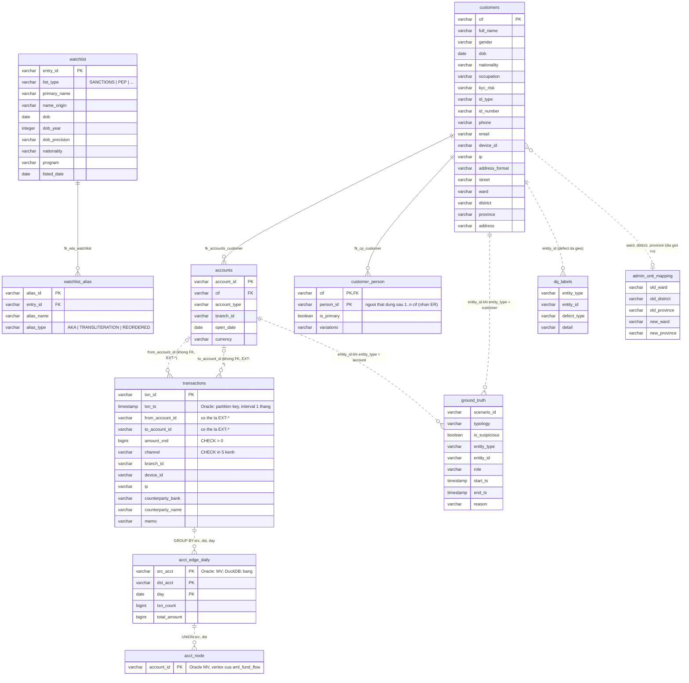

# 01 — Core data (Phase 1, 2a, 2b, 5b)

Dữ liệu tổng hợp do `aml datagen` sinh ra, nạp từ Parquet bằng `aml load`. Đây là các bảng duy nhất chứa PII.
Nguồn: `010_datagen.sql`, `030_constraints_indexes.sql`, `040_acct_edge_daily.sql`, `050_customers_masked.sql`,
`120_property_graph.sql` (Oracle).

## Ghi chú

| Đối tượng | Ghi chú |
|---|---|
| `customers` | Bảng PII duy nhất của khách hàng. Analyst đọc qua view `customers_masked` (giữ họ và chữ cái đầu, 4 ký tự cuối giấy tờ, 3 số cuối điện thoại, 1 ký tự email, `birth_year` thay `dob`). |
| `customer_person` | Nhãn sinh ra cùng dữ liệu: nhiều `cif` của cùng một người thật. Là ground truth cho entity resolution, không dùng ở runtime. |
| `transactions` | Không có FK về `accounts` vì `from/to_account_id` có thể là tài khoản ngoài hệ thống (`EXT-*`) và defect DQ được gieo có chủ đích. Oracle: `CHECK (amount_vnd > 0)`, `CHECK channel`, `CHECK (from IS NOT NULL OR to IS NOT NULL)`. |
| `acct_edge_daily` | Cạnh tài khoản → tài khoản gộp theo ngày, dùng cho SQL trace (CTE đệ quy) và benchmark SQL-vs-graph. |
| `acct_node` + `aml_fund_flow` | Chỉ Oracle 23ai. Property graph: vertex `account` (từ `acct_node`), edge `transfer` (từ `transactions`, `SOURCE from_account_id`, `DESTINATION to_account_id`, properties `txn_id, txn_ts, amount_vnd, channel`). Truy vấn bằng `GRAPH_TABLE ... MATCH`. |
| `ground_truth`, `dq_labels`, `admin_unit_mapping` | Bảng tham chiếu không khóa. `ground_truth` đánh giá rules/prioritization; `dq_labels` đánh giá DQ framework; `admin_unit_mapping` ánh xạ địa giới hành chính cũ sang mới cho chuẩn hóa địa chỉ. |
