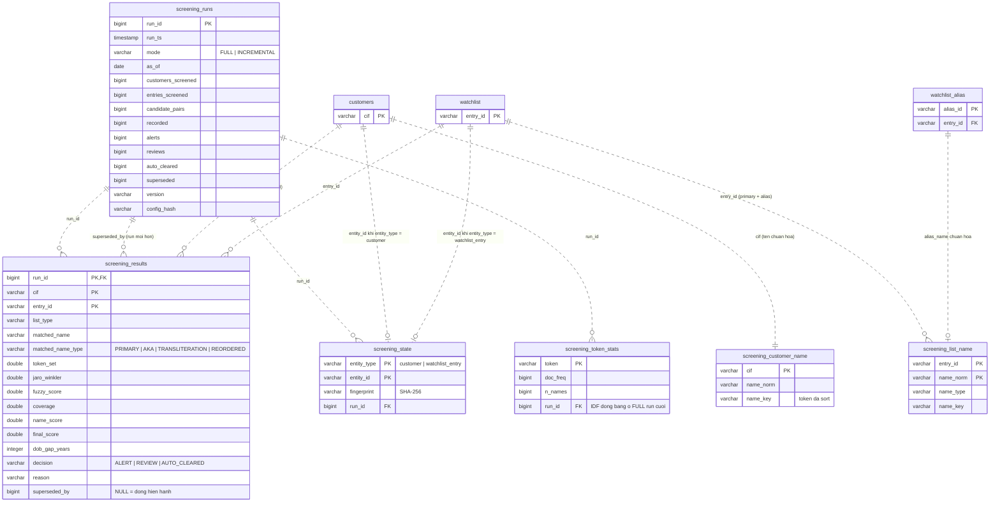

# 02 — Screening (Phase 3b, 3c)

Sàng lọc tên khách hàng (tiếng Việt, có dấu/không dấu, đảo thứ tự) với watchlist. Kết quả theo cặp
`(cif, entry_id)`, versioned theo `run_id`; dòng cũ không xóa mà đánh dấu `superseded_by`.
Nguồn: `080_screening.sql`, `090_screening_state.sql`.

## Ghi chú

| Đối tượng | Ghi chú |
|---|---|
| `screening_results` | Mỗi dòng là một quyết định có `reason`. View `screening_current` = `superseded_by IS NULL`. Chỉ lưu `cif`, không lưu tên khách hàng; `matched_name` là tên trong watchlist. |
| `screening_customer_name`, `screening_list_name` | Tên đã chuẩn hóa để screen bằng SQL (blocking theo `name_key`). Được rebuild từ `customers`, `watchlist`, `watchlist_alias`. |
| `screening_state` | Fingerprint lần screen gần nhất của từng entity. Chế độ INCREMENTAL chỉ screen entity có fingerprint thay đổi. `good_guy_list` (file 05) lưu lại fingerprint này để biết khi nào clearance hết hiệu lực. |
| `screening_token_stats` | IDF theo token, đóng băng ở FULL run gần nhất để điểm số của run INCREMENTAL so sánh được. |
