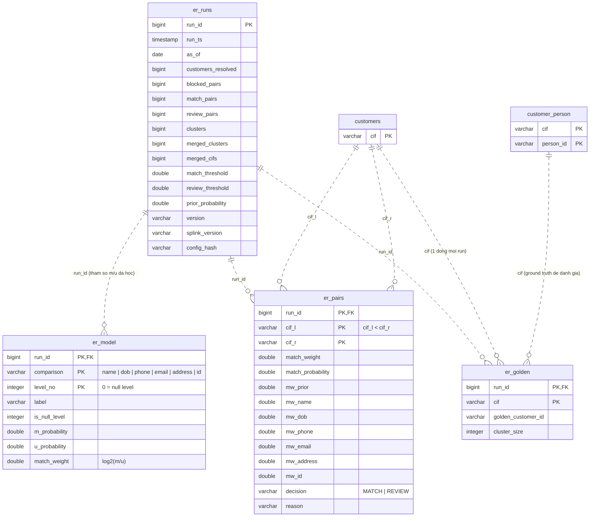

# 03 — Entity resolution (Phase 4)

Gộp nhiều `cif` của cùng một người thật thành một `golden_customer_id` bằng Splink (Fellegi-Sunter).
Append-only theo `run_id`; view `customer_golden` đọc run mới nhất. Chỉ lưu `cif`, không FK về `customers`.
Nguồn: `100_entity_resolution.sql`.

## Ghi chú

| Đối tượng | Ghi chú |
|---|---|
| `er_model` | Lưu nguyên tham số mô hình (m, u, match weight từng level) trong DB thay vì file, nên mỗi cặp trong `er_pairs` giải thích được bằng tổng các `mw_*`. |
| `er_pairs` | Một dòng mỗi cặp ứng viên qua blocking. `reason` là chuỗi người đọc được, liệt kê các trường đóng góp nhiều nhất. |
| `er_golden` | Ánh xạ `cif → golden_customer_id`. View `customer_golden` (run mới nhất) là khóa mà `cases` (file 05) và Neo4j node `Customer` (file 04) dùng. View `er_cluster_weights` tổng hợp theo cluster. |
