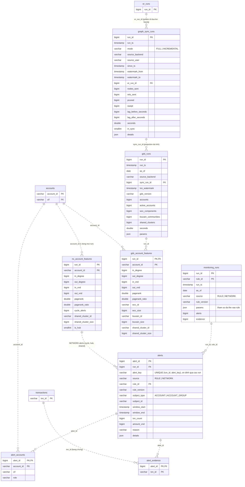
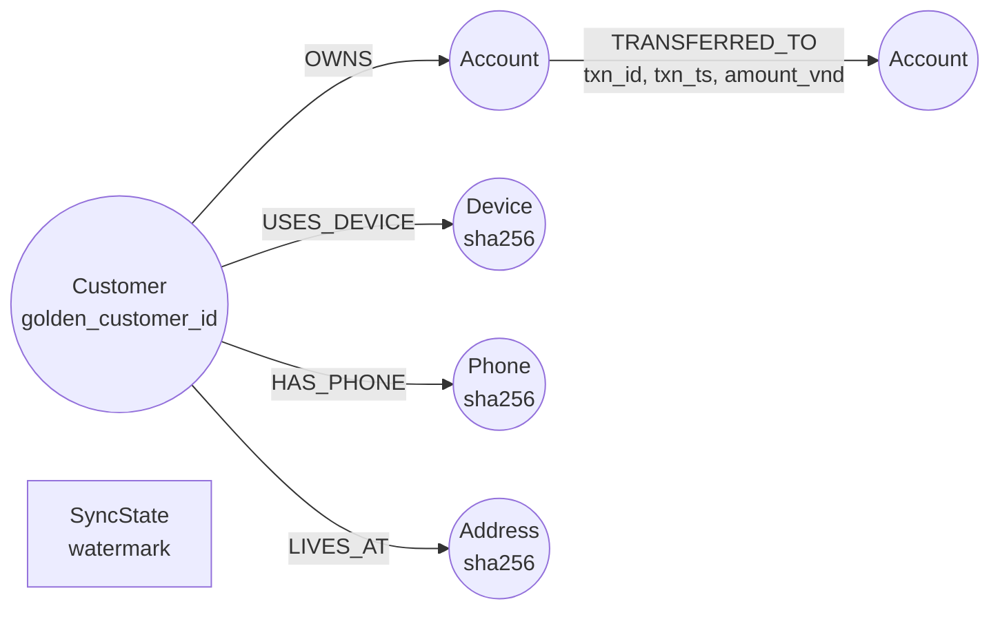

# 04 — Monitoring, network và Neo4j projection (Phase 5a, 5c, 6a, 6b)

Rules giao dịch (`source = RULE`) và phân tích mạng lưới (`source = NETWORK`, NetworkX trên DuckDB/Oracle hoặc
GDS trên Neo4j) cùng ghi vào `alerts`. Append-only theo `run_id`; view `alerts_current` đọc run mới nhất của từng rule.
Nguồn: `110_monitoring.sql`, `130_network.sql`, `140_graph_sync.sql`, `150_gds.sql`.

## Mô hình đồ thị Neo4j (read-only projection)

Neo4j không nằm trong schema quan hệ nhưng là đích của `graph_sync_runs`. Mô hình được `aml graph sync` xây bằng
`MERGE` từ view `graph_customer_attrs`, `accounts`, `transactions` và `customer_golden`:

| Node / rel | Ghi chú |
|---|---|
| `Customer` | Một node mỗi `golden_customer_id` (sau ER), không phải mỗi `cif`. |
| `Device`, `Phone`, `Address` | Khóa bằng sha256 của giá trị chuẩn hóa; giá trị thô không rời Oracle. Dùng cho shared-attribute cluster. |
| `TRANSFERRED_TO` | Một rel mỗi giao dịch có cả hai đầu là tài khoản nội bộ. |
| `SyncState` | Watermark sync incremental; không có bảng tương ứng phía Oracle. |

## Ghi chú

| Đối tượng | Ghi chú |
|---|---|
| `alerts` | `alert_key` ổn định qua các run (cùng rule, cùng subject, cùng cửa sổ) để Phase 7 nhận ra alert lặp. `details` giữ số liệu riêng từng rule. |
| `alert_accounts.cif` | Denormalize `cif` tại thời điểm chạy để case consolidation không phải join lại `accounts`. |
| `nx_account_features` vs `gds_account_features` | Cùng ý nghĩa, hai nguồn tính (NetworkX trên system of record / GDS trên Neo4j). `case_runs.graph_source` ghi lại run case dùng nguồn nào. |
| `graph_sync_runs`, `gds_runs` | Nhật ký chạy, cho phép truy vết feature GDS về đúng bản projection và run ER đã dùng. |
