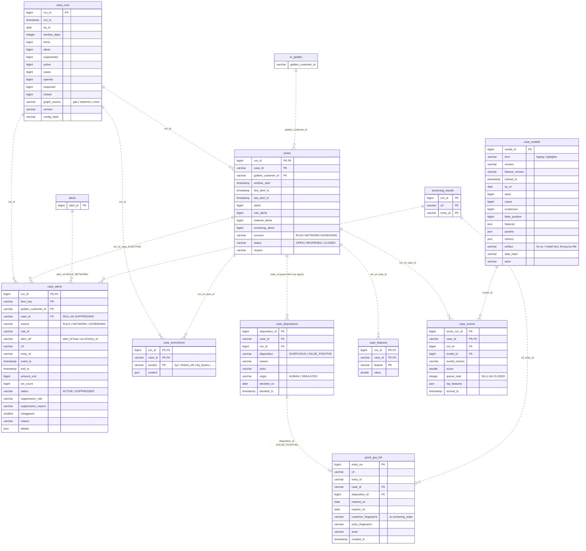

# 05 — Cases, suppression và prioritization (Phase 7a, 7b-supp, 7c)

Gom alert từ ba nguồn (RULE, NETWORK, SCREENING) thành một case mỗi golden customer mỗi cửa sổ trượt, kèm
enrichment và quyết định của người. Mô hình chỉ **xếp hạng** case: không bảng nào ở đây để mô hình đóng case.
Append-only theo `run_id`. Nguồn: `160_cases.sql`, `170_case_suppression.sql`, `180_case_prioritization.sql`.

## Ghi chú

| Đối tượng | Ghi chú |
|---|---|
| `cases` | Khóa nghiệp vụ `case_id` ổn định qua các run; mỗi run ghi lại trạng thái mới (OPEN → REOPENED khi alert lặp sau CLOSED). View `cases_current` đọc run mới nhất. |
| `case_alerts` | Mỗi item là một `(alert, golden customer)`. Item bị suppress vẫn được lưu với `suppression_rule`, `suppression_reason` và `case_id = NULL`, nên mọi suppression đều truy vết được. |
| `case_dispositions` | Bảng duy nhất ghi quyết định đóng/mở, và chỉ do người (`origin = HUMAN`) hoặc mô phỏng demo (`SIMULATED`). View `case_dispositions_current` lấy quyết định mới nhất mỗi case. |
| `good_guy_list` | Cặp `(cif, entry_id)` đã được clear là false positive. Hết hiệu lực khi quá `expires_on` hoặc fingerprint của khách hàng/entry trong `screening_state` thay đổi. Hibernation không có bảng riêng, tính lại mỗi run từ dispositions. |
| `case_features` | Lưu dạng dài `(case, feature, value)`: thêm feature là thêm dòng, không đổi schema. Feature memo của Phase 8d nằm riêng ở `case_memo_features` (file 06). |
| `case_models` | Mô hình lưu trọn trong DB (hệ số, danh sách feature, params, metrics, `data_hash` của tập train). View `case_model_active` = model mới nhất. |
| `case_scores` | Một dòng mỗi case mỗi lần chấm; `top_features` giải thích điểm. View `case_queue` join `cases_current` với điểm mới nhất, chỉ case OPEN/REOPENED. |
