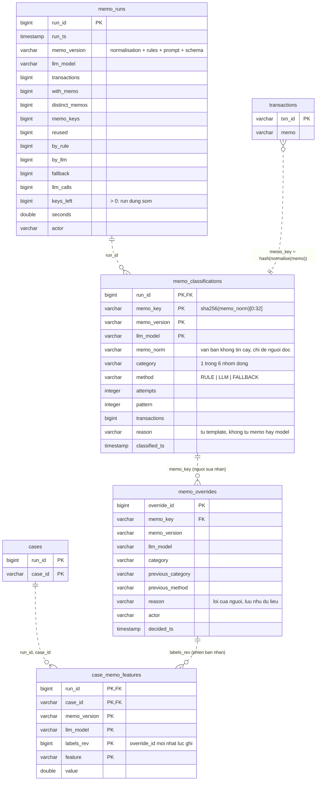

# 06 — Memo classification (Phase 8d)

Phân loại nội dung chuyển khoản (`transactions.memo`) vào 6 nhóm đóng bằng rule trước, LLM cục bộ (Ollama) sau.
Nhãn memo chỉ là **feature xếp hạng**; không bảng nào ở đây tạo alert hay đổi trạng thái case. Mỗi memo được phân
loại một lần theo khóa chuẩn hóa (`memo_key`), không theo từng giao dịch. Nguồn: `190_memo_analysis.sql`.

## Ghi chú

| Đối tượng | Ghi chú |
|---|---|
| `memo_classifications` | Một dòng mỗi câu trả lời của rule hoặc model cho một khóa. View `memo_classifications_current` đọc run mới nhất theo `(memo_key, memo_version, llm_model)`. `memo_norm` được coi là dữ liệu không tin cậy: không bao giờ đưa vào `reason` hay `audit_log`. |
| `memo_overrides` | Nhãn của người. Đổi ý là thêm dòng mới; dòng của model không bị sửa. View `memo_labels_current` cho nhãn đang hiệu lực, người thắng model (`method = HUMAN`). |
| `case_memo_features` | Sáu đếm theo nhóm cho mỗi case, tách khỏi `case_features` để feature set Phase 7c giữ nguyên. `labels_rev` ghi lại phiên bản nhãn đã dùng, nên điểm số truy vết được về đúng tập nhãn. |
