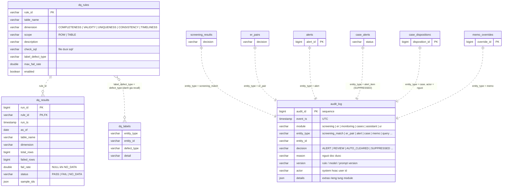

# 07 — Data quality và audit (Phase 0, 2c)

Hai bảng xuyên suốt mọi module: `audit_log` nhận mọi quyết định tự động hoặc của người, `dq_rules`/`dq_results`
đo chất lượng dữ liệu đầu vào. Cả hai đều append-only. Nguồn: `000_audit_log.sql`, `060_dq.sql`.

## Ghi chú

| Đối tượng | Ghi chú |
|---|---|
| `audit_log` | Quan hệ đa hình qua `(entity_type, entity_id)`, không FK. Mọi module ghi qua `aml.common.audit.audit()` / `audit_many()`; dòng dữ liệu và dòng audit nằm trong cùng `with db.transaction():`. Trên Oracle, role `aml_app` chỉ được grant INSERT, và unified audit policy `aml_audit_log_tamper` ghi lại mọi UPDATE/DELETE (`sql/oracle/security/`). Extras của từng module (câu hỏi assistant, Cypher sinh ra, ID đã truy xuất, feedback) đi vào `details` để schema lõi không đổi. |
| `dq_rules` | Catalogue rule DQ, mỗi rule trỏ tới một file SQL kiểm tra. `label_defect_type` nối với `dq_labels` để đo rule bắt được bao nhiêu defect đã gieo. |
| `dq_results` | Một dòng mỗi `(run, rule)`, insert-only. View `dq_trend` tính delta `failed_rows` giữa các run bằng `LAG`. `sample_ids` là các id lỗi nhỏ nhất để điều tra viên xem nhanh. |
